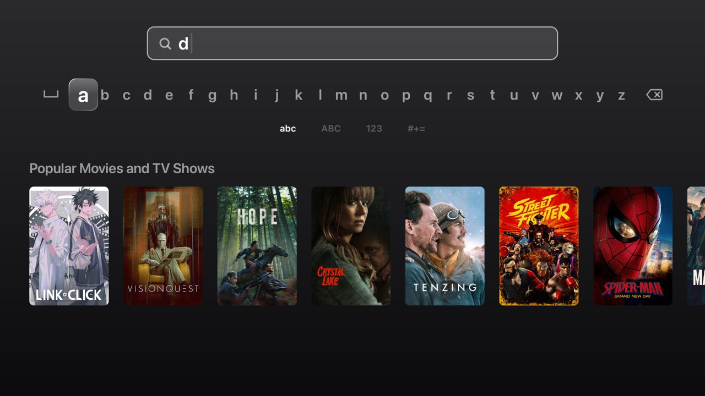
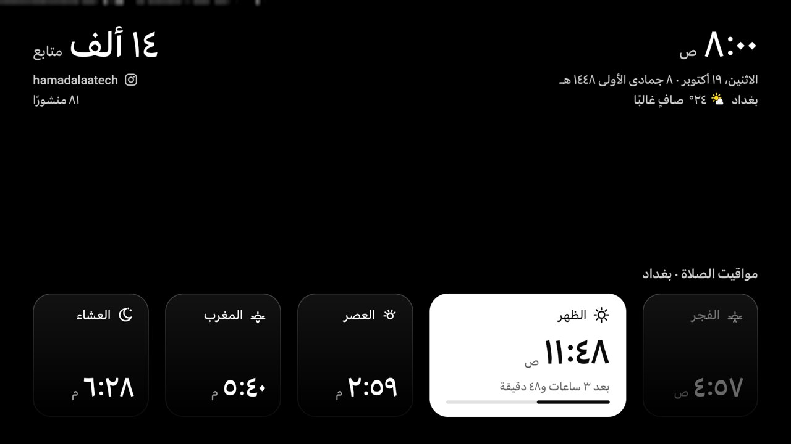
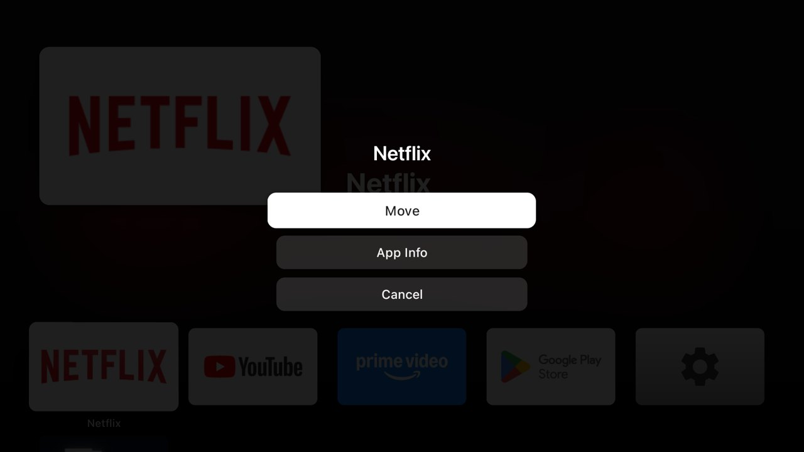

<div dir="rtl">

# tvhome — تجربة Apple TV ‏(tvOS) على جهاز Android TV

> 🇬🇧 English: [README.md](README.md)

يستبدل **tvhome** مُشغِّل الواجهة (launcher) في أي جهاز Android TV عادي بنظام متكامل على طراز Apple TV:
الشاشة الرئيسية، وTop Shelf، والبحث، والإعدادات، ومركز التحكم (Control Center)، ومبدِّل التطبيقات (App Switcher)، وشاشة التوقف
الجوية (Aerial screensaver) الخاصة بـ Apple. ويضم المشروع أيضًا شاشة توقف لمواقيت الصلاة في بغداد. كل شيء مكتوب بشكل أصلي (native)
بلغة Kotlin مع Jetpack Compose، ومصمَّم وفق إرشادات الواجهة البشرية (Human Interface Guidelines) الرسمية لـ tvOS،
ومضبوط ليعمل بسلاسة على جهاز Android 9 رخيص بذاكرة 2 GB.


| | |
|---|---|
|  |  |
|  |  |
|  |  |
|  |  |

> هذا المشروع غير تابع لشركة Apple Inc. ولا تؤيّده ولا يرتبط بها بأي شكل. "Apple TV" و"tvOS" و"SF Pro"
> علامات تجارية مملوكة لشركة Apple Inc. هذا المشروع دراسة تصميمية شخصية.

---

## 🤖 أعِد بناءه بالذكاء الاصطناعي: أمر واحد قابل للنسخ

الملف **[docs/MASTER-PROMPT.ar.md](docs/MASTER-PROMPT.ar.md)** يحتوي على أمر نصي واحد
(بالإنجليزية: [MASTER-PROMPT.md](docs/MASTER-PROMPT.md)). انسخه والصقه في Claude Code أو Cursor أو Codex
أو أي أداة مشابهة، فيبني النظام كاملًا مرحلةً بعد مرحلة. إن كنت تفضّل خطوات أصغر فاستخدم
[docs/PROMPTS.ar.md](docs/PROMPTS.ar.md).

---

## الميزات

| الواجهة | ما تقدّمه |
|---|---|
| **الشاشة الرئيسية (Home)** | شريط تبويبات (tab bar) عائم بخامة Liquid Glass ‏(البحث · الرئيسية · الأفلام · المسلسلات · التطبيقات · الإعدادات) مع كبسولة تركيز (focus) تنزلق بين التبويبات وساعة. ويعرض شريط العرض الرئيسي (hero carousel) بملء الشاشة محتوى حقيقيًا من TMDB (شعار العنوان، والبيانات الوصفية، وزرّا **Play** و**More Info**). وتحته الصفوف: تطبيقاتك، والأكثر رواجًا الآن، والأعلى على Netflix، والأعلى على Prime Video، والأفلام الشائعة، والمسلسلات الشائعة. |
| **الأفلام / المسلسلات** | شريط عرض رئيسي إضافة إلى صفوف الأكثر رواجًا والأعلى تقييمًا والتصنيفات. اختيار أي بطاقة يفتح صفحة العمل (product page). |
| **التطبيقات** | شبكة تطبيقات من 5 أعمدة على طراز tvOS. اضغط مطوّلًا على OK لتفعيل وضع الاهتزاز (jiggle mode) وإعادة الترتيب؛ وتوفّر قائمة الإجراءات (action sheet) خيارات: نقل / إخفاء / معلومات التطبيق / إلغاء التثبيت. |
| **البحث** | لوحة مفاتيح خطّية (linear keyboard) على طراز tvOS. تشمل النتائج التطبيقات المثبّتة والأفلام والمسلسلات من TMDB. وتحتوي صفحة العمل على زر للإعلان الترويجي (trailer) يفتحه في YouTube. |
| **الإعدادات** | تطبيق إعدادات على طراز tvOS مع مربّعات أيقونات تطبيقات لكل قسم. كل صف يقرأ حالة النظام الحقيقية أو يكتبها (وضع العرض، والشبكة، وشاشة التوقف، والتطبيقات، واللغة…). |
| **مركز التحكم** | **اضغط مطوّلًا على زر Home** من أي تطبيق: الساعة، والسكون، وشاشة التوقف، والشبكة، والبلوتوث، والبحث، والإعدادات، وشريط تمرير للصوت. |
| **مبدِّل التطبيقات** | **اضغط مرتين على زر Home**: تظهر التطبيقات الأخيرة على شكل بطاقات. اضغط للأعلى على أي بطاقة لإغلاق ذلك التطبيق. |
| **شاشة التوقف الجوية (Aerial)** | مقاطع الفيديو الجوية الأصلية من Apple ‏(114 مقطعًا تُبَثّ من خوادم Apple) مع تسميات توضيحية للمواقع وساعة. |
| **شاشة توقف مواقيت الصلاة** | خلفية من الفيديو الجوي مع مواقيت الصلاة في بغداد (المذهب الشيعي/طريقة الجعفري)، تُحسَب دون اتصال بالإنترنت (offline). تظهر الصلاة القادمة كمربّع "في حالة التركيز" مع عدّ تنازلي وشريط تقدّم. وتعرض أيضًا الساعة، والتاريخين الميلادي والهجري، وطقس بغداد، وعدّاد متابعين على Instagram. |

تأتي قواعد التصميم من [`docs/HIG-tvOS.md`](docs/HIG-tvOS.md)، وهو مواصفة مُلزِمة مستخلَصة من جميع صفحات HIG
البالغ عددها 102 والتي تتضمن إرشادات خاصة بـ tvOS. وتغطي المنطقة الآمنة (safe area)، وسلّم الخطوط (type scale) في tvOS، وأحجام الشبكات،
ومقاييس شريط التبويبات، وحالات التركيز، وتأثير المنظور المتحرك (parallax)، وLiquid Glass.

---

## المتطلبات

| العنصر | الإصدار / ملاحظة |
|---|---|
| جهاز Android TV | Android 8.0 أو أحدث (minSdk 26). طُوِّر وضُبط على جهاز تلفاز منخفض المواصفات بنظام Android 9 مع ذاكرة 2 GB RAM. |
| JDK | الإصدار 21 (يعمل JBR المضمَّن مع Android Studio) |
| Android SDK | المنصّة 36 + أدوات البناء (build-tools) |
| `adb` | حزمة Platform-tools، ومُضافة إلى `PATH` |
| حساب TMDB | **رمز وصول للقراءة (Read Access Token)** مجاني للواجهة البرمجية من <https://www.themoviedb.org/settings/api> |

---

## 1 · البناء (Build)

```bash
git clone <this repo> tvhome && cd tvhome

# local.properties is git-ignored — create it:
cat > local.properties <<'EOF'
sdk.dir=/path/to/Android/sdk
TMDB_READ_TOKEN=eyJhbGciOi...your TMDB read token...
INSTAGRAM_HANDLE=yourhandle   # optional, for the prayer screensaver
EOF

export JAVA_HOME="/Applications/Android Studio.app/Contents/jbr/Contents/Home"   # JDK 21
./gradlew :app:testReleaseUnitTest :app:assembleRelease
# → app/build/outputs/apk/release/app-release.apk
```

**ثبِّت دائمًا نسخة الإصدار (release build).** فهي مُصغَّرة بأداة R8 وموقَّعة بمفتاح التصحيح (debug key) لذا
تُثبَّت مباشرة. أما نسخة Compose القابلة للتصحيح (debuggable) فأبطأ بشكل ملحوظ على أجهزة التلفاز الضعيفة.

---

## 2 · التثبيت على جهاز التلفاز

فعِّل **خيارات المطوّر ← تصحيح الأخطاء عبر USB/الشبكة** (Developer options → USB/Network debugging) على الجهاز، ثم:

```bash
adb connect <box-ip>:5555          # or plug in USB
adb install -r app/build/outputs/apk/release/app-release.apk
```

### اجعله الشاشة الرئيسية

```bash
adb shell cmd package set-home-activity com.hamad.tvhome/.MainActivity
# The stock Google TV launcher outranks third-party launchers — disable it (reversible):
adb shell pm disable-user --user 0 com.google.android.tvlauncher
adb shell input keyevent KEYCODE_HOME
```

### تفعيل مركز التحكم ومبدِّل التطبيقات (على مستوى النظام)

يعمل هذان كخدمة إمكانية وصول (accessibility service) في عملية (process) مستقلة، لذا يعملان فوق أي تطبيق.

```bash
adb shell settings put secure enabled_accessibility_services \
  com.hamad.tvhome/com.hamad.tvhome.system.SystemUiService
adb shell settings put secure accessibility_enabled 1
adb shell appops set com.hamad.tvhome GET_USAGE_STATS allow      # recent apps for the switcher
```

### أذونات تطبيق الإعدادات (ليتمكّن من تغيير الإعدادات مباشرة)

```bash
adb shell pm grant com.hamad.tvhome android.permission.WRITE_SECURE_SETTINGS
adb shell appops set com.hamad.tvhome WRITE_SETTINGS allow
```

### اختيار شاشة التوقف

```bash
# Prayer Times dashboard (over Aerial video):
adb shell settings put secure screensaver_components \
  com.hamad.tvhome/com.hamad.tvhome.dashboard.PrayerDashboardDream
# …or plain Aerial:
# com.hamad.tvhome/com.hamad.tvhome.aerial.AerialDreamService
adb shell settings put secure screensaver_enabled 1

# Preview it now:
adb shell am start -n com.android.systemui/.Somnambulator
```

يمكنك أيضًا اختيار شاشة التوقف ومدة التأخير قبل بدئها وخياراتها من داخل **الإعدادات ← شاشة التوقف** (Settings → Screen Saver).

### اختياري: الحفاظ على صحة الساعة بعد انقطاع الكهرباء

الأجهزة التي لا تحتوي على بطارية ساعة حقيقية (RTC) تُقلِع على تاريخ المصنع. وعند تفعيل DNS الخاص المشفَّر (Private DNS)
يُعطِّل هذا التاريخ الخاطئ عملية DNS، فلا تتمكن الساعة من المزامنة أبدًا. الحل هو توجيه NTP إلى عنوان IP مباشرة:

```bash
adb shell settings put global ntp_server 162.159.200.123   # time.cloudflare.com
```

---

## 3 · خريطة أزرار جهاز التحكم عن بُعد

| الزر | الإجراء |
|---|---|
| D-pad (أزرار الاتجاهات) | تحريك التركيز |
| OK | فتح / اختيار |
| ضغطة مطوّلة على OK | وضع الاهتزاز (إعادة ترتيب التطبيقات) / خيارات إضافية |
| Back | الرجوع مستوى واحدًا؛ ولا يفعل شيئًا على شريط تبويبات الشاشة الرئيسية |
| Home | العودة إلى تبويب الرئيسية |
| ضغطة مطوّلة على Home | مركز التحكم |
| ضغطتان على Home | مبدِّل التطبيقات |
| Menu / Play-Pause | قائمة الإجراءات للتطبيق الذي عليه التركيز |

---

## 4 · الإعدادات والتهيئة (Configuration)

| ماذا | أين |
|---|---|
| رمز TMDB | `local.properties` ← `TMDB_READ_TOKEN`، ويُتاح للشيفرة باسم `BuildConfig.TMDB_READ_TOKEN` |
| منطقة المحتوى (صفّا Netflix/Prime) | الإعدادات ← الشاشة الرئيسية ← منطقة Top Shelf ‏(Settings → Home Screen → Top Shelf Region)، وتُخزَّن في `prefs/LauncherPrefs.kt` |
| مدينة الصلاة وطريقة الحساب | `prayer/PrayerTimes.kt` ← `PrayerConfig.BaghdadJafari` (خط العرض/الطول، وفارق التوقيت عن UTC، وزوايا الفجر/العشاء/المغرب) |
| مدن الطقس | `dashboard/DashboardData.kt` ← `CITIES` ‏(Open-Meteo، بلا مفتاح) |
| حساب Instagram | `local.properties` ← `INSTAGRAM_HANDLE=yourhandle` (فارغ = مخفي) |
| التطبيقات المخفية، وأصوات النقر، وخيارات شاشة التوقف | تطبيق الإعدادات (تُخزَّن في `LauncherPrefs`) |

---

## 5 · بنية المشروع

```
app/src/main/java/com/hamad/tvhome/
├── design/      tvOS design kit: TvType (HIG type scale), TvColors, TvDims, LiquidGlass, TvButton/TvRow
├── ui/ home/    Home screen: tab bar, hero carousel, rows, app grid, focus motion, content repository
├── search/      Search app: linear keyboard, results, product page
├── settings/    Settings app: pages, icon tiles, system info readers
├── system/      Accessibility service: Home-key router, Control Center, App Switcher overlays
├── aerial/      Aerial screensaver: Apple catalogue (.tar/plist), ExoPlayer playback, TLS for Apple's CA
├── dashboard/   Prayer-times screensaver: layout, weather + Instagram data, Arabic formatting
├── prayer/      Offline prayer-time astronomy (PrayTimes algorithm) + schedule logic
├── tmdb/        TMDB v3 client (trending, providers, search, details, title logos)
├── prefs/       LauncherPrefs (shared settings, StateFlow)
└── AppRepository, OrderStore, GridNav, MainActivity, HomeViewModel
docs/HIG-tvOS.md   the binding design spec
AGENTS.md          instructions for AI coding agents (also AGENTS.ar.md)
docs/PROMPTS.md    the prompt playbook to rebuild this with an LLM (also PROMPTS.ar.md)
```

---

## 6 · مصادر البيانات (بيانات حقيقية فقط)

| البيانات | المصدر | ملاحظات |
|---|---|---|
| الأفلام والمسلسلات | TMDB API v3 | يتطلب ذكر المصدر: *يستخدم هذا المنتج واجهة TMDB البرمجية، لكنه غير مُعتمَد ولا مُصادَق عليه من TMDB.* (This product uses the TMDB API but is not endorsed or certified by TMDB.) |
| الفيديوهات الجوية | `sylvan.apple.com` (موجز tvOS العام من Apple) | تُبَثّ مباشرة ولا يُعاد توزيعها أبدًا. شهادة الجذر (root CA) الخاصة بـ Apple مضمَّنة لذلك النطاق فقط. |
| مواقيت الصلاة | تُحسَب على الجهاز نفسه | خوارزمية PrayTimes بزوايا الجعفري (الفجر 16°، المغرب 4°، العشاء 14°). مُختبَرة باختبارات الوحدة (unit tests) مقابل Aladhan بفارق لا يتجاوز دقيقة واحدة. |
| الطقس | Open-Meteo | مجاني، بلا مفتاح |
| متابعو Instagram | صفحة الملف الشخصي العامة | لا يكشف Instagram لغير المسجَّلين إلا الرقم المقرَّب (مثل "14K"). أما العدد الدقيق فيحتاج إلى Instagram Graph API الرسمية. |
| التاريخ الهجري / رمضان | ICU `IslamicCalendar` (أم القرى) | |

عند فشل أي مصدر، تُخفي الواجهة ذلك العنصر. ولا تعرض أبدًا أرقامًا مختلَقة.

---

## 7 · الأداء (مَقيس على جهاز Android 9 بذاكرة 2 GB)

| المقياس | النتيجة |
|---|---|
| الشاشة الرئيسية في وضع السكون | **0 إطارات** مرسومة، و0 % من المعالج (CPU) (لا توجد أي حركات أثناء الخمول) |
| التنقّل بين الصفوف | نحو 2 % من الإطارات متقطعة (janky)، وp90 بين 13 و16 ms |
| التبديل بين التبويبات | أسوأ إطار 24 ms. تبقى الصفحات مُركَّبة (composed) ومُحمَّلة مسبقًا (prefetched)؛ وكبسولة التركيز تنزلق. |
| شاشة توقف الصلاة | تُعيد الرسم مرة واحدة كل دقيقة |

كيف تحقّق ذلك: حركات تعتمد على graphicsLayer فقط، وطبقتان كحدٍّ أقصى بملء الشاشة، وتظليلات (scrims) مُعَدّة مسبقًا لشريط العرض الرئيسي،
وفكّ ترميز الصور بأحجام محدودة، وخدمة إمكانية الوصول في عملية مستقلة (`:system`)، بحيث لا تنتظر تصفية المفاتيح
خيط الواجهة (UI thread) أبدًا.

---

## 8 · الاختبارات

```bash
./gradlew :app:testReleaseUnitTest
```

تغطي اختبارات الوحدة الـ 64 التنقّلَ في الشبكة، وتمريرَ الصفوف، والحسابات الفلكية لمواقيت الصلاة (مقارنة بـ Aladhan)،
وجدولَ الصلوات، وصيغ الجمع والأرقام العربية، وموجِّه زر Home ‏(Home-key router)، وترتيبَ التطبيقات الأخيرة، وتحليلَ
فهرس الفيديوهات الجوية.

---

## 9 · إلغاء التثبيت / استعادة المشغِّل الأصلي

```bash
adb shell pm enable com.google.android.tvlauncher
adb shell settings put secure enabled_accessibility_services ""
adb uninstall com.hamad.tvhome
# packages removed with "pm uninstall --user 0 <pkg>" come back with:
adb shell cmd package install-existing <pkg>
```

---

## 10 · استكشاف الأخطاء وإصلاحها

| العَرَض | الحل |
|---|---|
| توقّفت الضغطة المطوّلة / الضغطتان على Home عن العمل بعد تحديث | كلٌّ من `adb install -r` و`am force-stop` يفصل خدمة إمكانية الوصول. أعِد تنفيذ أمرَي `settings put secure …`؛ وإن لم تُربَط الخدمة بعد ذلك، نفِّذ `adb reboot`. |
| لقطات شاشة التوقف تُظهر الفيديو أسود | أمر طبيعي: كثير من أجهزة التلفاز ترسم الفيديو على طبقة عتادية (hardware plane) لا يراها `screencap`. تحقّق على التلفاز مباشرة، أو استخدم محاكيًا (emulator). |
| الأمر `adb shell input keyevent` لا يفتح مركز التحكم | المفاتيح المُحقَنة تتجاوز مُرشِّح المفاتيح في خدمة إمكانية الوصول. استخدم جهاز التحكم الحقيقي (أو `uinput` على المحاكي). |
| الساعة تعرض عام 2017 بعد انقطاع الكهرباء | راجع قسم "الحفاظ على صحة الساعة" أعلاه. |
| بطاقة الصلاة / اللوحة مخفية | تُخفي البطاقة نفسها ما دامت ساعة النظام غير مضبوطة (السنة أقل من 2025)، حتى لا تعرض مواقيت خاطئة أبدًا. |

---

## ⚠️ قبل نشر هذا المستودع

- **خطوط SF Pro / SF Arabic** ‏(`app/src/main/res/font/sf_*`) مرخَّصة من Apple للاستخدام على منصات Apple
  فقط. احذفها من أي نسخة عامة (fork) واستبدل بها خطًّا مفتوحًا (مثل Inter / IBM Plex
  Sans Arabic) بتعديل `design/Tv.kt → TvFonts`.
- يحتوي `local.properties` على رمز TMDB الخاص بك وهو مُستثنى من git ‏(git-ignored). أبقِه كذلك.

## الترخيص

مشروع شخصي؛ لم يُمنَح أي ترخيص بعد. أضِف ترخيصًا قبل النشر.

</div>
